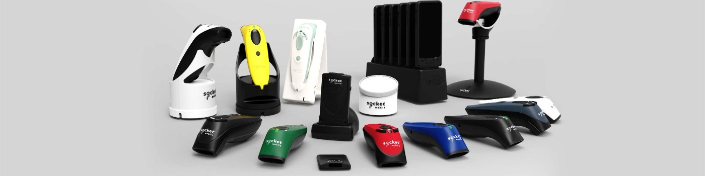

# 📌 **Welcome to CaptureSDK**

- 🎯 **Unified SDK for data capture:** Seamlessly access and control all Socket Mobile devices.  
- 📸 **Supports all devices:**  
  - Camera-based scanners: **C820**, **C860**  
  - Hardware products: **Barcode readers**, **NFC reader/writers**, **Barcode/NFC combo**  
  - **All-in-one integration** for a simplified experience  
- 📚 **Learn more:** Visit the [SDK documentation site](https://docs.socketmobile.dev) for detailed guidance.

---

# 🚀 **Don’t Miss Out on Updates!**  

- 🔧 **Continuous improvement:** We enhance CaptureSDK daily across all supported platforms.  
- 🔔 **Stay up-to-date:** Regular updates ensure easier upgrades and better data collection performance.  
- 👀 **Recommendation:** Watch the repositories of the platforms your application uses to stay informed about new versions.  

---

# 💬 **General Feedback & Issues**

Have a feature request, a general improvement idea, or feedback about our [Developer Portal](https://www.socketmobile.dev)? This is the right place to share it, regardless of the platform you use.

👉 [Submit a general issue](https://github.com/SocketMobile/general-issues)

---

# 🔧 **Platforms / SDKs**

## iOS development

|      CaptureSDK     |  Note |
|----------|-------|
| [CaptureSDK - Swift Package Manager](https://github.com/SocketMobile/swift-package-capturesdk) | Swift and Objective C |

|      Sample     |  Note |
|----------|-------|
| [SingleEntry Swift (Swift Package Manager)](https://github.com/SocketMobile/capturesingleentryswift-ios) | Swift and Objective C |

## Android development

|      CaptureSDK     |  Note |
|----------|-------|
| [CaptureSDK - Android](https://github.com/SocketMobile/android-capturesdk) | Java and Kotlin |

This [repository](https://github.com/SocketMobile/samples-android/tree/main/hellocapture) is updated at each release of the CaptureSDK for Android, you can watch for it to not miss out on new releases.

Android SDK is hosted on Maven. Refer to **[this link](https://docs.socketmobile.com/capture/java/en/latest/android/getting-started.html#add-the-sdk-to-your-project)** for how to add the SDK for Android or plain Java development.

|      Sample     |  Note |
|----------|-------|
| [HelloCapture](https://github.com/SocketMobile/samples-android/tree/main/hellocapture) | For barcode scanning |
| [HelloCaptureBLE](https://github.com/SocketMobile/samples-android/tree/main/hellocapture-ble-android) | For NFC reader/writer (Bluetooth LE devices) |

## Windows development

|      CaptureSDK     |  Note |
|----------|-------|
| [CaptureSDK - Windows](https://github.com/SocketMobile/windows-capturesdk) | C# |

Windows CaptureSDK is hosted on Nuget. Refer to **[this link](https://www.nuget.org/packages/SocketMobile.Capture)** for how to add the SDK.

|      Sample     |  Note |
|----------|-------|
| [Single Entry UWP](https://github.com/SocketMobile/capturesingleentry-uwp) | For Windows |

## Cross platform development

|      CaptureSDK     |  Note |
|----------|-------|
| [CaptureSDK - React Native](https://github.com/SocketMobile/react-native-capture) | Javascript / Typescript |
| [CaptureSDK - Flutter](https://github.com/SocketMobile/capturesdk_flutter) | Dart |
| [CaptureSDK - .NET MAUI](https://github.com/SocketMobile/csharp-capturesdk) | C# |

The CaptureSDK .NET MAUI (from 1.7.34.67) is hosted and back to public on Nuget.org. Refer to **[this link](https://www.nuget.org/packages/SocketMobile.Capture)** for how to add the CaptureSDK to your .MAUI project.

The React Native CaptureSDK (from 1.5.111) is back to public. Refer also to **[this link](https://www.npmjs.com/package/react-native-capture)** for how to add the CaptureSDK as a npm package.

The Flutter CaptureSDK (from 1.5.41) is back to public. It supports SocketCam C820 and C860 and can be installed by following the instructions from our [Developers Portal](https://www.socketmobile.dev).

The samples below need to be updated with the instructions found in the [Developers Portal](https://www.socketmobile.dev).

|      Sample     |  Note |
|----------|------|
| [SingleEntry RN](https://github.com/SocketMobile/singleentry-rn) | For iOS and Android |
| [Capture Flutter Sample](https://github.com/SocketMobile/capture_flutter_sdk_sample) | For iOS and Android|
| [Capture .NET MAUI Sample](https://github.com/SocketMobile/capture_maui_sdk_sample) | For iOS, Android and Windows|
